# Modelo entidad-relación de la plataforma

Este archivo documenta el modelo conceptual de la base de datos. El diagrama está escrito en Mermaid: GitHub lo puede mostrar como diagrama dentro de este archivo Markdown. **No es SQL ejecutable** y todavía no crea tablas en PostgreSQL.

## Acuerdos principales

- Los roles son Administrador, Central, Call Center, Droguería y Domiciliario. Cada perfil tiene un único rol.
- Existe una Central compartida. “Central 1” y “Central 2” son usuarios del equipo, no entidades Central distintas.
- Supabase Auth gestiona correo, contraseña y autenticación. `PERFILES.id` referencia el usuario de Auth; no se guardan contraseñas en `PERFILES`.
- `EMPRESAS` queda prevista para el futuro. En la primera versión no limita la rotación: el personal de droguería autorizado puede elegir cualquier droguería activa al iniciar cada jornada.
- Los estados del pedido son `PENDIENTE`, `ACEPTADO`, `EN_ENTREGA`, `ENTREGADO` y `CANCELADO`. El retraso se calcula y no es estado. `EXTERNA` es una modalidad de entrega, no un estado.
- La entidad escogida para la jornada se registra en `JORNADAS` y en el historial de acciones.
- La autorización de personal de droguería se concede una vez; no restringe el lugar donde puede trabajar.
- El reloj de retraso usa `disponible_desde`; se reinicia cuando un pedido liberado vuelve a estar disponible. A los 10 minutos se marca crítico y se avisa a Central.
- La entrega externa es una modalidad, no un estado del pedido, y requiere su registro en `ENTREGAS_EXTERNAS`.
- El historial de pedidos es append-only. No se guardan deudas ni pagos; el reporte se calcula.
- Administrador hereda las funciones de Central, incluidas edición y cancelación; las acciones se registran en historial.
- La revisión de dudas pendientes y recomendaciones está en [`docs/decisiones/dudas-y-decisiones.md`](docs/decisiones/dudas-y-decisiones.md).

## Diagrama

```mermaid
erDiagram
    %% 18 tablas propias. IDs UUID. Fechas con zona horaria.
    %% AUTH_USERS es Supabase Auth; PERFILES.id referencia AUTH_USERS.id.
    %% Roles: ADMINISTRADOR, CENTRAL, CALL_CENTER, DROGUERIA, DOMICILIARIO.
    %% Cada perfil tiene un solo rol. Correo y contraseña se gestionan en Supabase Auth.
    %% EMPRESAS queda prevista para ampliaciones futuras y no restringe la rotación actual.
    %% El personal autorizado puede elegir cualquier droguería activa al iniciar jornada.
    %% JORNADAS.entidad_activa_id registra dónde trabaja durante esa jornada.
    %% La autorización de droguería es única y no ata al usuario a una sola droguería.
    %% Una cuenta principal por entidad: AUTORIZACIONES.es_principal.
    %% disponible_desde inicia con el pedido y se actualiza cuando vuelve a estar disponible.
    %% El retraso se calcula desde disponible_desde; al minuto 10 se avisa a Central.
    %% modalidad_entrega = INTERNA o EXTERNA; no es un estado del pedido.
    %% Si es EXTERNA, debe existir un registro correspondiente en ENTREGAS_EXTERNAS.
    %% Historial append-only. No se guardan deudas ni pagos; el reporte se calcula.
    %% Las reglas de empresa son futuras y no limitan esta primera versión.

    EMPRESAS {
        uuid id PK
        text nombre
        text estado
        timestamptz creado_en
    }

    AUTH_USERS {
        uuid id PK
        text email
    }

    PERFILES {
        uuid id PK, FK
        text nombre_completo
        text telefono
        text direccion
        text ciudad
        text rol
        text estado_cuenta
        timestamptz creado_en
    }

    ENTIDADES_OPERATIVAS {
        uuid id PK
        uuid empresa_id FK "nullable; alcance futuro"
        text tipo "DROGUERIA, CENTRAL o CALL_CENTER"
        text nombre
        text direccion
        text telefono
        text estado
        timestamptz creado_en
    }

    AUTORIZACIONES {
        uuid id PK
        uuid perfil_id FK
        uuid entidad_id FK
        uuid autorizado_por FK "nullable"
        boolean es_principal
        text estado
        timestamptz autorizado_en
    }

    SOLICITUDES_DOMICILIARIO {
        uuid id PK
        uuid perfil_id FK
        uuid revisado_por FK "nullable mientras pendiente"
        text estado
        text observacion
        timestamptz solicitada_en
        timestamptz revisada_en
    }

    JORNADAS {
        uuid id PK
        uuid perfil_id FK
        uuid entidad_activa_id FK "nullable para roles sin sede"
        timestamptz iniciada_en
        timestamptz finalizada_en "nullable mientras abierta"
    }

    BARRIOS {
        uuid id PK
        text nombre
        text ciudad
        boolean activo
    }

    PEDIDOS {
        uuid id PK
        uuid creado_por FK
        uuid entidad_origen_id FK
        uuid drogueria_recogida_id FK
        uuid barrio_id FK
        text direccion_entrega
        text estado "PENDIENTE, ACEPTADO, EN_ENTREGA, ENTREGADO o CANCELADO"
        text modalidad_entrega
        timestamptz creado_en
        timestamptz disponible_desde
    }

    ASIGNACIONES_PEDIDO {
        uuid id PK
        uuid pedido_id FK
        uuid domiciliario_id FK
        uuid asignado_por FK "nullable si acepta por cuenta propia"
        text estado
        text motivo_liberacion
        timestamptz asignado_en
        timestamptz aceptado_en
        timestamptz liberado_en
    }

    ENTREGAS_EXTERNAS {
        uuid id PK
        uuid pedido_id FK
        uuid coordinado_por FK
        text empresa_externa
        text nombre_repartidor
        text telefono_repartidor
        text estado
        timestamptz coordinado_en
        timestamptz entregado_en
    }

    RECOGIDAS {
        uuid id PK
        uuid pedido_id FK
        uuid drogueria_id FK
        uuid validado_por FK
        timestamptz validada_en
    }

    SOLICITUDES_CANCELACION {
        uuid id PK
        uuid pedido_id FK
        uuid solicitada_por FK
        uuid revisada_por FK "nullable mientras pendiente"
        text motivo
        text estado
        timestamptz solicitada_en
        timestamptz revisada_en
    }

    DEVOLUCIONES {
        uuid id PK
        uuid pedido_id FK
        uuid devuelto_por FK
        uuid recibido_por FK
        uuid entidad_recepcion_id FK
        text motivo
        timestamptz registrada_en
    }

    ANEXOS {
        uuid id PK
        uuid pedido_id FK
        uuid drogueria_recogida_id FK
        text descripcion
        integer cantidad
        timestamptz creado_en
    }

    HISTORIAL_PEDIDO {
        uuid id PK
        uuid pedido_id FK
        uuid perfil_id FK
        uuid entidad_activa_id FK "nullable"
        text accion
        text estado_anterior
        text estado_nuevo
        text motivo
        timestamptz ocurrido_en
    }

    NOTIFICACIONES {
        uuid id PK
        uuid perfil_destinatario_id FK
        uuid pedido_id FK "nullable"
        uuid solicitud_domiciliario_id FK "nullable"
        text tipo
        text mensaje
        timestamptz creada_en
        timestamptz leida_en "nullable"
    }

    METAS {
        uuid id PK
        uuid definida_por FK
        integer cantidad_objetivo
        numeric valor_por_dia_cumplido
        date vigente_desde
        date vigente_hasta "nullable mientras vigente"
        timestamptz creada_en
    }

    MENSAJES_SOPORTE {
        uuid id PK
        uuid remitente_id FK
        uuid destinatario_perfil_id FK "nullable"
        uuid destinataria_entidad_id FK "nullable"
        uuid pedido_id FK "nullable"
        text mensaje
        timestamptz enviado_en
        timestamptz leido_en "nullable"
    }

    EMPRESAS o|--o{ ENTIDADES_OPERATIVAS : "agrupa; uso futuro"
    AUTH_USERS ||--|| PERFILES : "cuenta de acceso"
    PERFILES ||--o{ AUTORIZACIONES : "usuario autorizado"
    ENTIDADES_OPERATIVAS ||--o{ AUTORIZACIONES : "entidad que autoriza"
    PERFILES o|--o{ AUTORIZACIONES : "autoriza"
    PERFILES ||--o{ SOLICITUDES_DOMICILIARIO : "solicita"
    PERFILES o|--o{ SOLICITUDES_DOMICILIARIO : "revisa"
    PERFILES ||--o{ JORNADAS : "abre"
    ENTIDADES_OPERATIVAS o|--o{ JORNADAS : "sede elegida para la jornada"
    PERFILES ||--o{ PEDIDOS : "crea"
    ENTIDADES_OPERATIVAS ||--o{ PEDIDOS : "entidad de origen"
    ENTIDADES_OPERATIVAS ||--o{ PEDIDOS : "drogueria de recogida"
    BARRIOS ||--o{ PEDIDOS : "barrio de entrega"
    PEDIDOS ||--o{ ASIGNACIONES_PEDIDO : "tiene asignaciones"
    PERFILES ||--o{ ASIGNACIONES_PEDIDO : "domiciliario"
    PERFILES o|--o{ ASIGNACIONES_PEDIDO : "asigna o reasigna"
    PEDIDOS ||--o{ ENTREGAS_EXTERNAS : "puede tener"
    PERFILES ||--o{ ENTREGAS_EXTERNAS : "coordina"
    PEDIDOS ||--o{ RECOGIDAS : "registra"
    ENTIDADES_OPERATIVAS ||--o{ RECOGIDAS : "drogueria"
    PERFILES ||--o{ RECOGIDAS : "valida"
    PEDIDOS ||--o{ SOLICITUDES_CANCELACION : "puede recibir"
    PERFILES ||--o{ SOLICITUDES_CANCELACION : "solicita"
    PERFILES o|--o{ SOLICITUDES_CANCELACION : "revisa"
    PEDIDOS ||--o{ DEVOLUCIONES : "puede tener"
    PERFILES ||--o{ DEVOLUCIONES : "devuelve"
    PERFILES ||--o{ DEVOLUCIONES : "recibe"
    ENTIDADES_OPERATIVAS ||--o{ DEVOLUCIONES : "lugar de recepcion"
    PEDIDOS ||--o{ ANEXOS : "puede incluir"
    ENTIDADES_OPERATIVAS ||--o{ ANEXOS : "drogueria de recogida"
    PEDIDOS ||--o{ HISTORIAL_PEDIDO : "conserva eventos"
    PERFILES ||--o{ HISTORIAL_PEDIDO : "realiza accion"
    ENTIDADES_OPERATIVAS o|--o{ HISTORIAL_PEDIDO : "sede activa"
    PERFILES ||--o{ NOTIFICACIONES : "recibe"
    PEDIDOS o|--o{ NOTIFICACIONES : "pedido relacionado"
    SOLICITUDES_DOMICILIARIO o|--o{ NOTIFICACIONES : "solicitud relacionada"
    PERFILES ||--o{ METAS : "define versiones globales"
    PERFILES ||--o{ MENSAJES_SOPORTE : "remitente"
    PERFILES o|--o{ MENSAJES_SOPORTE : "destinatario perfil"
    ENTIDADES_OPERATIVAS o|--o{ MENSAJES_SOPORTE : "destinataria entidad"
    PEDIDOS o|--o{ MENSAJES_SOPORTE : "pedido relacionado"
```

## Reglas que se implementarán al crear las tablas SQL

- Una cuenta principal por entidad, identificada en `AUTORIZACIONES.es_principal`.
- Una sola jornada abierta por perfil.
- Una asignación interna activa por pedido.
- El destinatario de un mensaje de soporte debe ser exactamente un perfil o una entidad.
- Las validaciones de rol, autorización y estado deben impedir operaciones no permitidas.
- Las restricciones futuras entre empresas se agregarán cuando se acuerde activarlas; no afectan la rotación de la primera versión.

## Próximo paso

Este documento es el modelo y sirve para revisar la estructura. Para crear las tablas en PostgreSQL hay que traducirlo a SQL, idealmente en migraciones numeradas, y ejecutar esas migraciones en la base de datos.
